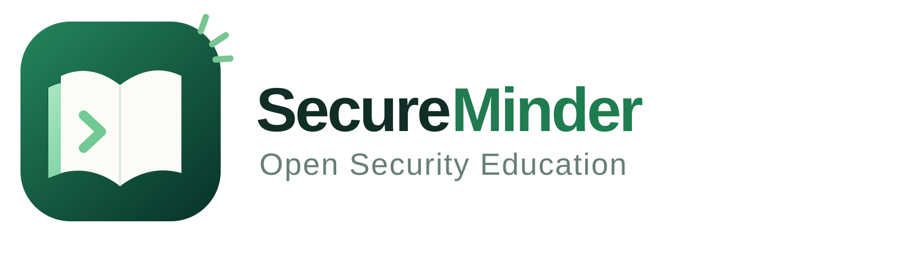

# Open Security Education

SecureMinder is a hands-on security education project, and this repository
contains its public curriculum.

## Learning Paths

Choose the path that matches what you want to work on:

- [Penetration Testing](curriculum/penetration-testing.md)
- [Kubernetes Security](curriculum/kubernetes-security.md)
- [AI Security](curriculum/ai-security.md)

## Get Involved

You can fix a mistake, make an explanation clearer or suggest a new lesson. Read [CONTRIBUTING.md](CONTRIBUTING.md) before opening a pull request.

If the lessons have helped you, you can also [support SecureMinder on GitHub Sponsors](https://github.com/sponsors/secureminder).

[Start learning at secureminder.com](https://secureminder.com)
